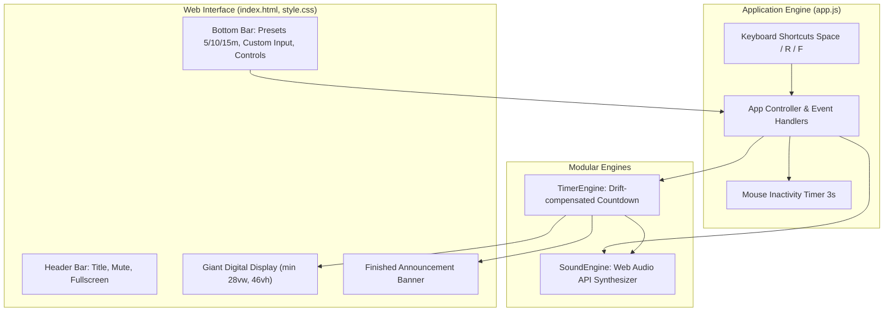

# Classroom TV Timer Implementation Plan

> **For agentic workers:** REQUIRED SUB-SKILL: Use superpowers:subagent-driven-development to implement this plan task-by-task. Steps use checkbox (`- [ ]`) syntax for tracking.

**Goal:** Build a zero-dependency, high-visibility classroom TV web timer app with 5m/10m/15m presets, custom input, ultra-large digits readable from the back of the classroom, 1-minute color shift warning, screen-flashing finish alert with school chime sound, and auto-hiding controls.

**Architecture:** A lightweight, modular vanilla JavaScript web application. The core timer logic is separated into an accurate drift-compensated `TimerEngine`, the synthesized audio uses browser `Web Audio API` in `SoundEngine`, styled with responsive viewport units (`clamp`, `vw/vh`) in `style.css`, and tied together with keyboard and auto-hide interactions in `app.js`.

**Architecture Diagram:**



**Tech Stack:** HTML5, CSS3, Modern JavaScript (ES Modules), Web Audio API, Node.js built-in test runner (`node --test`), Playwright MCP for E2E verification.

## Global Constraints
- Zero external runtime dependencies (no npm install required for running the web app).
- Fully functional offline by opening `index.html` directly in modern browsers (Chrome, Edge, Whale, Safari).
- Ultra-high contrast display optimized for classroom TV (visible from 8~10m away).
- Audio synthesized via Web Audio API without requiring external MP3/WAV downloads.

---

### Task 1: Core Timer Engine (`src/timer-core.js`)

**Files:**
- Create: `src/timer-core.js`
- Test: `tests/timer-core.test.mjs`

**Interfaces:**
- Produces:
  - `formatTime(totalSeconds: number): string`
  - `parseCustomTime(minutesStr: string, secondsStr: string): number`
  - `class TimerEngine`:
    - `constructor({ onTick, onWarning, onFinish, onStateChange })`
    - `setDuration(seconds: number): void`
    - `addSeconds(seconds: number): void`
    - `start(): void`
    - `pause(): void`
    - `reset(): void`
    - `getState(): { remainingSeconds, totalDuration, isRunning, isWarning, isFinished }`

- [ ] **Step 1: Write the failing tests for `timer-core`**

```javascript
// tests/timer-core.test.mjs
import { test, describe } from 'node:test';
import assert from 'node:assert/strict';
import { formatTime, parseCustomTime, TimerEngine } from '../src/timer-core.js';

describe('timer-core utilities', () => {
  test('formatTime formats seconds into MM:SS correctly', () => {
    assert.equal(formatTime(300), '05:00');
    assert.equal(formatTime(65), '01:05');
    assert.equal(formatTime(9), '00:09');
    assert.equal(formatTime(0), '00:00');
  });

  test('formatTime formats >= 3600 seconds into HH:MM:SS', () => {
    assert.equal(formatTime(3665), '01:01:05');
  });

  test('parseCustomTime parses minutes and seconds properly', () => {
    assert.equal(parseCustomTime('5', '0'), 300);
    assert.equal(parseCustomTime('10', '30'), 630);
    assert.equal(parseCustomTime('0', '45'), 45);
    assert.equal(parseCustomTime('-1', '0'), 0);
    assert.equal(parseCustomTime('abc', 'def'), 0);
  });
});

describe('TimerEngine lifecycle', () => {
  test('initial state and setDuration', () => {
    const timer = new TimerEngine({});
    timer.setDuration(300);
    const state = timer.getState();
    assert.equal(state.remainingSeconds, 300);
    assert.equal(state.totalDuration, 300);
    assert.equal(state.isRunning, false);
    assert.equal(state.isWarning, false);
    assert.equal(state.isFinished, false);
  });

  test('warning flag triggers at 60 seconds or below', () => {
    let warningFired = false;
    const timer = new TimerEngine({
      onWarning: () => { warningFired = true; }
    });
    timer.setDuration(60);
    assert.equal(timer.getState().isWarning, true);
  });
});
```

- [ ] **Step 2: Run test to verify it fails**

Run: `node --test tests/timer-core.test.mjs`
Expected: FAIL with Cannot find module `../src/timer-core.js`

- [ ] **Step 3: Implement `src/timer-core.js`**

```javascript
// src/timer-core.js
export function formatTime(totalSeconds) {
  const safeSeconds = Math.max(0, Math.floor(totalSeconds));
  const hours = Math.floor(safeSeconds / 3600);
  const minutes = Math.floor((safeSeconds % 3600) / 60);
  const seconds = safeSeconds % 60;

  const mm = String(minutes).padStart(2, '0');
  const ss = String(seconds).padStart(2, '0');

  if (hours > 0) {
    const hh = String(hours).padStart(2, '0');
    return `${hh}:${mm}:${ss}`;
  }
  return `${mm}:${ss}`;
}

export function parseCustomTime(minutesStr, secondsStr) {
  const mins = parseInt(minutesStr, 10);
  const secs = parseInt(secondsStr, 10);
  const validMins = Number.isFinite(mins) && mins >= 0 ? mins : 0;
  const validSecs = Number.isFinite(secs) && secs >= 0 ? secs : 0;
  return (validMins * 60) + validSecs;
}

export class TimerEngine {
  constructor({ onTick = () => {}, onWarning = () => {}, onFinish = () => {}, onStateChange = () => {} } = {}) {
    this.onTick = onTick;
    this.onWarning = onWarning;
    this.onFinish = onFinish;
    this.onStateChange = onStateChange;

    this.totalDuration = 300;
    this.remainingSeconds = 300;
    this.isRunning = false;
    this.timerId = null;
    this.lastTimestamp = null;
    this.warningFired = false;
  }

  setDuration(seconds) {
    const valid = Math.max(0, Math.floor(seconds));
    this.pause();
    this.totalDuration = valid;
    this.remainingSeconds = valid;
    this.warningFired = false;
    this._notify();
  }

  addSeconds(seconds) {
    if (this.isFinished()) return;
    this.remainingSeconds = Math.max(0, this.remainingSeconds + seconds);
    this.totalDuration = Math.max(this.totalDuration, this.remainingSeconds);
    if (this.remainingSeconds > 60) {
      this.warningFired = false;
    }
    this._notify();
  }

  start() {
    if (this.isRunning || this.remainingSeconds <= 0) return;
    this.isRunning = true;
    this.lastTimestamp = Date.now();
    this._notify();

    this.timerId = setInterval(() => {
      const now = Date.now();
      const elapsed = (now - this.lastTimestamp) / 1000;
      this.lastTimestamp = now;

      this.remainingSeconds = Math.max(0, this.remainingSeconds - elapsed);
      const roundedRemaining = Math.ceil(this.remainingSeconds);

      if (roundedRemaining <= 60 && !this.warningFired && roundedRemaining > 0) {
        this.warningFired = true;
        this.onWarning(roundedRemaining);
      }

      this._notify();

      if (this.remainingSeconds <= 0) {
        this.pause();
        this.remainingSeconds = 0;
        this.onFinish();
        this._notify();
      }
    }, 100);
  }

  pause() {
    if (this.timerId) {
      clearInterval(this.timerId);
      this.timerId = null;
    }
    this.isRunning = false;
    this._notify();
  }

  reset() {
    this.pause();
    this.remainingSeconds = this.totalDuration;
    this.warningFired = false;
    this._notify();
  }

  isFinished() {
    return this.remainingSeconds <= 0;
  }

  getState() {
    const rounded = Math.ceil(this.remainingSeconds);
    return {
      remainingSeconds: rounded,
      rawRemaining: this.remainingSeconds,
      totalDuration: this.totalDuration,
      isRunning: this.isRunning,
      isWarning: rounded > 0 && rounded <= 60,
      isFinished: this.remainingSeconds <= 0 && this.totalDuration > 0
    };
  }

  _notify() {
    const state = this.getState();
    this.onTick(state);
    this.onStateChange(state);
  }
}
```

- [ ] **Step 4: Run tests and verify they pass**

Run: `node --test tests/timer-core.test.mjs`
Expected: PASS

- [ ] **Step 5: Commit**

```bash
git add src/timer-core.js tests/timer-core.test.mjs
git commit -m "feat: implement timer core engine with unit tests"
```

---

### Task 2: Web Audio API Sound Engine (`src/sound-engine.js`)

**Files:**
- Create: `src/sound-engine.js`
- Test: `tests/sound-engine.test.mjs`

**Interfaces:**
- Produces:
  - `class SoundEngine`:
    - `constructor({ isMuted = false })`
    - `init(): void`
    - `toggleMute(): boolean`
    - `setMute(muted: boolean): void`
    - `isMuted(): boolean`
    - `playWarningDing(): void`
    - `playFinishChime(): void`

- [ ] **Step 1: Write test for SoundEngine logic**

```javascript
// tests/sound-engine.test.mjs
import { test, describe } from 'node:test';
import assert from 'node:assert/strict';
import { SoundEngine } from '../src/sound-engine.js';

describe('SoundEngine mute state management', () => {
  test('mute toggle and initial status', () => {
    const sound = new SoundEngine({ isMuted: false });
    assert.equal(sound.isMuted(), false);

    const newState = sound.toggleMute();
    assert.equal(newState, true);
    assert.equal(sound.isMuted(), true);

    sound.setMute(false);
    assert.equal(sound.isMuted(), false);
  });

  test('sound triggers do not throw in non-browser environment without AudioContext', () => {
    const sound = new SoundEngine();
    assert.doesNotThrow(() => sound.playWarningDing());
    assert.doesNotThrow(() => sound.playFinishChime());
  });
});
```

- [ ] **Step 2: Run test to verify it fails**

Run: `node --test tests/sound-engine.test.mjs`
Expected: FAIL with Cannot find module `../src/sound-engine.js`

- [ ] **Step 3: Implement `src/sound-engine.js`**

```javascript
// src/sound-engine.js
export class SoundEngine {
  constructor({ isMuted = false } = {}) {
    this.muted = isMuted;
    this.audioCtx = null;
  }

  _getAudioContext() {
    if (typeof window === 'undefined') return null;
    const AudioContextClass = window.AudioContext || window.webkitAudioContext;
    if (!AudioContextClass) return null;

    if (!this.audioCtx) {
      this.audioCtx = new AudioContextClass();
    }
    if (this.audioCtx.state === 'suspended') {
      this.audioCtx.resume();
    }
    return this.audioCtx;
  }

  init() {
    this._getAudioContext();
  }

  toggleMute() {
    this.muted = !this.muted;
    return this.muted;
  }

  setMute(isMuted) {
    this.muted = Boolean(isMuted);
  }

  isMuted() {
    return this.muted;
  }

  _playTone(freq, startTime, duration, type = 'sine', gainLevel = 0.25) {
    const ctx = this._getAudioContext();
    if (!ctx || this.muted) return;

    try {
      const osc = ctx.createOscillator();
      const gain = ctx.createGain();

      osc.type = type;
      osc.frequency.setValueAtTime(freq, startTime);

      gain.gain.setValueAtTime(gainLevel, startTime);
      gain.gain.exponentialRampToValueAtTime(0.0001, startTime + duration);

      osc.connect(gain);
      gain.connect(ctx.destination);

      osc.start(startTime);
      osc.stop(startTime + duration);
    } catch {
      // Graceful fallback if AudioContext is blocked
    }
  }

  playWarningDing() {
    if (this.muted) return;
    const ctx = this._getAudioContext();
    if (!ctx) return;

    const now = ctx.currentTime;
    // C5 (523.25Hz) followed by G5 (783.99Hz)
    this._playTone(523.25, now, 0.25, 'sine', 0.2);
    this._playTone(783.99, now + 0.22, 0.45, 'sine', 0.25);
  }

  playFinishChime() {
    if (this.muted) return;
    const ctx = this._getAudioContext();
    if (!ctx) return;

    const now = ctx.currentTime;
    // Classic 4-note chime (E5 -> C5 -> D5 -> G4)
    const notes = [
      { freq: 659.25, time: 0.0, dur: 0.5 }, // E5 (미)
      { freq: 523.25, time: 0.45, dur: 0.5 }, // C5 (도)
      { freq: 587.33, time: 0.9, dur: 0.5 }, // D5 (레)
      { freq: 392.00, time: 1.35, dur: 1.0 } // G4 (솔)
    ];

    notes.forEach(note => {
      this._playTone(note.freq, now + note.time, note.dur, 'triangle', 0.3);
      // Subtle harmonics for a warm school bell sound
      this._playTone(note.freq * 2, now + note.time, note.dur * 0.7, 'sine', 0.1);
    });
  }
}
```

- [ ] **Step 4: Run tests and verify they pass**

Run: `node --test tests/sound-engine.test.mjs`
Expected: PASS

- [ ] **Step 5: Commit**

```bash
git add src/sound-engine.js tests/sound-engine.test.mjs
git commit -m "feat: implement Web Audio API sound engine with unit tests"
```

---

### Task 3: Classroom TV HTML Structure & CSS Styling (`index.html`, `style.css`)

**Files:**
- Create: `index.html`
- Create: `style.css`

**Key UI Requirements:**
- Header: Editable title `#activity-title`, mute button `#btn-mute`, fullscreen button `#btn-fullscreen`.
- Display: Giant digits `#timer-display` with `tabular-nums` and `font-size: min(28vw, 46vh)`.
- Progress indicator: `#progress-bar` showing remaining percentage.
- Finished Banner: `#finish-banner` overlay with "🔔 활동 시간이 종료되었습니다!".
- Controls:
  - Preset buttons: `#preset-5`, `#preset-10`, `#preset-15`
  - Custom inputs: `#input-minutes`, `#input-seconds`, `#btn-set-custom`
  - Actions: `#btn-toggle-start`, `#btn-reset`, `#btn-add-minute`
- CSS States:
  - `.state-warning`: Neon amber text color (`#f59e0b`) + gentle 1-second pulse.
  - `.state-finished`: Full screen flash animation (red/gold flashing background) + finished banner reveal.
  - `.controls-hidden`: Smooth transition `opacity: 0, pointer-events: none` for mouse inactivity auto-hide.

- [ ] **Step 1: Create `index.html`**
- [ ] **Step 2: Create `style.css`**
- [ ] **Step 3: Verify static page renders correctly in headless browser**
- [ ] **Step 4: Commit**

```bash
git add index.html style.css
git commit -m "feat: create high-visibility classroom TV markup and styles"
```

---

### Task 4: Application Controller, Auto-hide & Shortcuts (`app.js`)

**Files:**
- Create: `app.js`

**Responsibilities:**
- Instantiate `TimerEngine` and `SoundEngine`.
- Wire up preset buttons (5m, 10m, 15m) to set timer and reset state.
- Wire up custom input validation and set button.
- Wire up start/pause, reset, +1m buttons.
- Connect timer tick events to update display digits and progress bar.
- Trigger sound & UI state on 1m warning and 0s finished events.
- Implement mouse movement tracker with 3-second debounce to add/remove `.controls-hidden`.
- Implement keyboard shortcuts: `Space` (toggle start/pause), `R` (reset), `F` (toggle fullscreen).
- Allow clicking `#activity-title` to edit text with prompt/inline edit.

- [ ] **Step 1: Implement `app.js`**
- [ ] **Step 2: Test interactivity locally via node or browser**
- [ ] **Step 3: Commit**

```bash
git add app.js
git commit -m "feat: connect timer controller with auto-hide and keyboard shortcuts"
```

---

### Task 5: End-to-End Verification with Playwright Browser Testing

**Verification Steps:**
- Serve `d:\Codex\class-timer` on a local HTTP port.
- Use Playwright MCP tools to test:
  1. Initial screen rendering: 05:00 default display, title, preset buttons, controls.
  2. Click 10분 preset: display updates to 10:00.
  3. Custom input: enter 1분 10초 and click 설정 -> display shows 01:10.
  4. Start timer -> timer counts down accurately.
  5. Warning test: set timer to 62s, run for 3s -> crosses 60s -> verifies `.state-warning` class and color shift.
  6. Finish test: set timer to 2s, run -> reaches 0s -> verifies `.state-finished` class, screen flash animation, and finish banner visibility.
  7. Mute toggle button test: icon toggles between 🔔 and 🔕.
  8. Auto-hide test: after waiting while running, controls get `.controls-hidden`.
  9. Keyboard shortcut test: spacebar pauses and resumes.
- Take screenshots of normal state, 1-minute warning state, and finished state for evidence.

- [ ] **Step 1: Start local server & run automated browser validation**
- [ ] **Step 2: Verify all user requirements pass**
- [ ] **Step 3: Commit and finalize**
